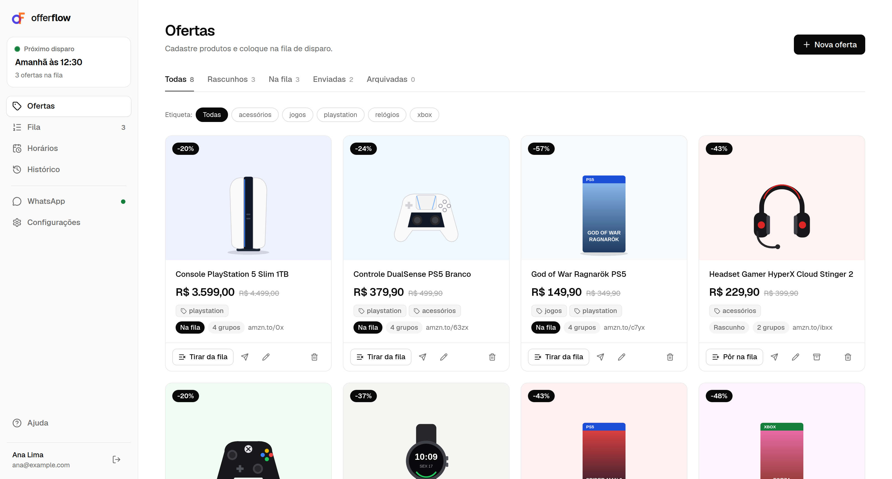

# Offer Flow React

<!-- markdownlint-disable MD033 -->

<div align="center">
  
  <h1><b>Offer Flow React</b></h1>
  <p>React frontend to manage product offers and dispatch them to WhatsApp groups on a schedule.</p>
  <p>
    
    
    
  </p>
</div>

<p align="center">
  
</p>

<!-- markdownlint-enable MD033 -->

## Table of Contents

- [Overview](#overview)
- [Features](#features)
- [Project Structure](#project-structure)
- [Prerequisites](#prerequisites)
- [Manual Installation (Ubuntu/Debian)](#manual-installation-ubuntudebian)
- [Environment Configuration](#environment-configuration)
- [Running the Application](#running-the-application)
- [Pages](#pages)
- [Image From Link](#image-from-link)
- [How Live Updates Work](#how-live-updates-work)
- [License](#license)

## Overview

The Offer Flow React is the frontend of the [Offer Flow Flask API](https://github.com/id0ubl3g/offer-flow-flask-api), developed with React, Vite and TypeScript. It lets each user register product offers, connect their WhatsApp number through a QR code, choose which groups receive the promotions, organize the queue and the dispatch times, and follow the result of every send.

## Features

- Login, register and password recovery with automatic access token refresh
- Offer editor with prices, discount, message template preview and image upload
- Product image, name and prices filled automatically from the offer link
- Tags on offers and groups, so each group receives only the offers that match it
- Offer queue in dispatch order and test send to a single group before queueing
- WhatsApp connection with live QR code and group sync
- Weekly dispatch times with next dispatch preview, delays between groups and daily limit
- Dispatch history per run and per group with retry of failed sends
- Onboarding guide with the setup steps and selling tips
- Default message template saved in the browser and light, dark and system themes

## Project Structure

```plaintext
└── offer-flow-react/
  ├── .github/
  │   ├── abacus-logo.png
  │   └── home.png
  ├── dev/
  │   └── linkPreview.ts
  ├── public/
  │   └── favicon.svg
  ├── src/
  │   ├── api/
  │   │   ├── client.ts
  │   │   └── types.ts
  │   ├── auth/
  │   │   └── AuthContext.tsx
  │   ├── components/
  │   │   ├── Layout.tsx
  │   │   ├── Logo.tsx
  │   │   ├── MessageTemplate.tsx
  │   │   ├── Onboarding.tsx
  │   │   ├── Tags.tsx
  │   │   ├── Toast.tsx
  │   │   └── ui.tsx
  │   ├── live/
  │   │   └── LiveContext.tsx
  │   ├── pages/
  │   │   ├── AuthShell.tsx
  │   │   ├── ForgotPasswordPage.tsx
  │   │   ├── HistoryPage.tsx
  │   │   ├── LoginPage.tsx
  │   │   ├── OfferEditor.tsx
  │   │   ├── OffersPage.tsx
  │   │   ├── QueuePage.tsx
  │   │   ├── RegisterPage.tsx
  │   │   ├── SchedulesPage.tsx
  │   │   ├── SettingsPage.tsx
  │   │   └── WhatsAppPage.tsx
  │   ├── utils/
  │   │   ├── format.ts
  │   │   ├── linkData.ts
  │   │   ├── schedule.ts
  │   │   ├── tags.ts
  │   │   ├── template.ts
  │   │   └── theme.ts
  │   ├── App.tsx
  │   ├── main.tsx
  │   └── styles.css
  ├── .env.example
  ├── .gitignore
  ├── index.html
  ├── LICENSE
  ├── package.json
  ├── package-lock.json
  ├── README.md
  ├── tsconfig.json
  └── vite.config.ts
```

## Prerequisites

To run the Offer Flow React, use Ubuntu 22.04, 24.04 or 26.04 (or a similar Debian-based system) with Node.js 20 or higher and npm. The app needs a running instance of the [Offer Flow Flask API](https://github.com/id0ubl3g/offer-flow-flask-api), with its dispatch worker, to log in and send offers.

## Manual Installation (Ubuntu/Debian)

Update system & install base dependencies

```sh
sudo apt update && sudo apt upgrade -y
sudo apt install -y git curl
```

### Install Node.js

Install Node.js 22 from the NodeSource repository:

```sh
curl -fsSL https://deb.nodesource.com/setup_22.x | sudo -E bash -
sudo apt install -y nodejs
```

For other systems, follow the official guide: [https://nodejs.org/en/download](https://nodejs.org/en/download)

## Environment Configuration

Configure environment variables

```sh
cp .env.example .env
```

Configure the environment variables in `.env`:

| Variable | Description |
| -------- | ----------- |
| `VITE_API_URL` | Public URL of the Offer Flow Flask API, for example `https://api.example.com` |

When `VITE_API_URL` is set, the browser calls the API directly, so the frontend origin must be allowed in the backend `CORS_ORIGINS`. Without it, the app calls `/api` and the Vite dev server forwards the requests to the API through the proxy in `vite.config.ts`.

Vite reads the variables when the server starts or the build runs, so restart `npm run dev` after changing `.env`.

## Running the Application

```sh
git clone https://github.com/id0ubl3g/offer-flow-react
cd offer-flow-react
npm install
npm run dev
```

The `npm run dev` command starts the Vite dev server on `http://localhost:5173`.

| Command | Description |
| ------- | ----------- |
| `npm run dev` | Start the dev server with hot reload |
| `npm run build` | Type-check and build the app into `dist/` |
| `npm run preview` | Serve the `dist/` build locally |

Scheduled dispatches are sent by the backend worker, so the API and the worker must be running for queued offers to go out.

## Pages

| Route | Description |
| ----- | ----------- |
| `/login` | Logs in with email and password. |
| `/register` | Creates a new account. |
| `/forgot-password` | Sends the recovery code by email and sets a new password. |
| `/offers` | Lists, creates, edits, test sends and queues offers. |
| `/queue` | Shows queued offers in dispatch order. |
| `/schedules` | Manages dispatch times, delays between groups and daily limit. |
| `/whatsapp` | Connects the number with a QR code and activates groups. |
| `/history` | Lists dispatch runs with the result for each group. |
| `/settings` | Default message template, theme, account data and account deletion. |

Every route except `/login`, `/register` and `/forgot-password` requires a logged-in user.

## Image From Link

In the offer editor, pasting the product link (or clicking **Preencher pelo link**) downloads the main picture of the page and uses it as the offer image. The product name and prices are filled from the page when they are found.

1. The lookup runs in a Vite dev server middleware (`dev/linkPreview.ts`), because the browser cannot read pages from other sites due to CORS. For this reason it only works with `npm run dev`.
2. The middleware accepts only public `http` and `https` addresses and validates every redirect.
3. The image is read from `og:image`, JSON-LD or the main Amazon product image.
4. Sites with anti-bot protection, such as Mercado Livre, may not return the image.

## How Live Updates Work

1. While the page is visible, the app checks the WhatsApp connection every 5 seconds, or every 3 seconds while a QR code is waiting to be scanned.
2. The queue, schedules and groups are refreshed every 15 seconds, so changes made by the worker appear without reloading the page.
3. Polling pauses when the tab is hidden and resumes when it becomes visible again.
4. The access token is refreshed 60 seconds before it expires. A request rejected with `401` is retried once after refreshing, and `GET` requests that fail with a network or server error are retried once.

## License

This project is licensed under the terms of the [Apache License 2.0](http://www.apache.org/licenses/LICENSE-2.0). See the [LICENSE](./LICENSE) file for details.
